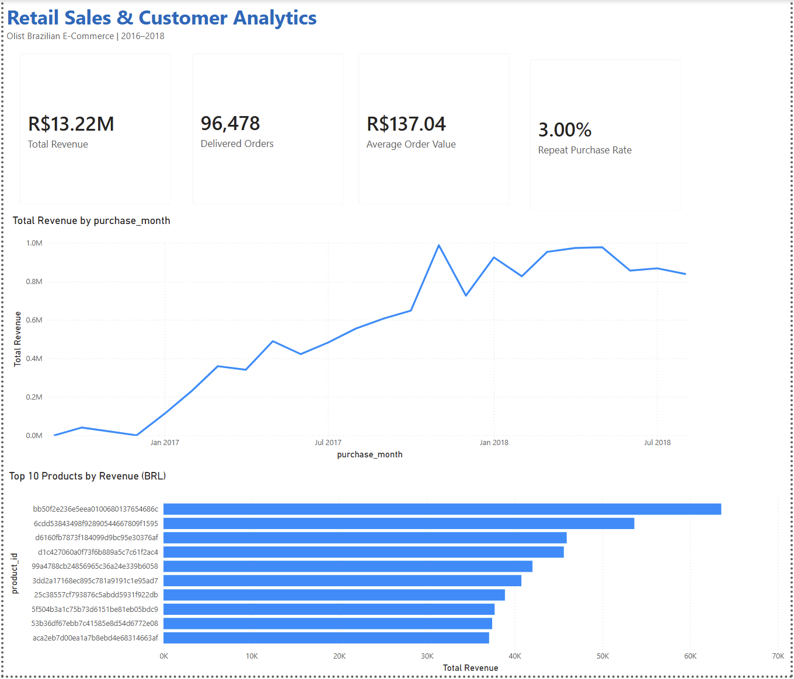

# Retail Sales & Customer Analytics

An end-to-end retail analytics project using Python, MySQL, and Power BI to explore e-commerce sales performance, customer purchasing behavior, and product revenue.

## Project Overview

This project analyzes the Olist Brazilian E-Commerce dataset (2016–2018) to identify sales trends, evaluate customer repeat purchasing, and explore product-level performance.

The analysis focuses on delivered orders. Product revenue excludes freight charges.

## Tools & Technologies

- **Python (Pandas):** Data exploration, cleaning, transformation, and KPI validation
- **MySQL:** SQL queries for sales trends, customer purchasing behavior, and product performance
- **Power BI:** Interactive dashboard and business performance visualization

## Key Performance Indicators

| Metric | Result |
|---|---|
| Total Product Revenue | R$13,221,498.11 |
| Delivered Orders | 96,478 |
| Average Order Value | R$137.04 |
| Repeat Purchase Rate | 3.00% |

## Dashboard

The Power BI dashboard includes four KPI cards, monthly revenue trends, and the top 10 products by revenue.



## Key Business Insights

1. **Customer Repeat Purchasing:** Only 3.00% of customers placed multiple delivered orders during the observed period, suggesting an opportunity to investigate repeat purchasing behavior.
2. **Revenue Growth:** Monthly revenue increased substantially during 2017, reaching approximately R$987,765 in November.
3. **Product Performance:** The highest-revenue product generated R$63,560 from 194 units sold, demonstrating the importance of analyzing both sales volume and revenue.

For detailed findings, recommendations, and limitations, see [Business Insights](Docs/business_insights.md).

## Project Structure

```text
Retail Analytics/
├── Data/
│   ├── Raw/
│   └── Cleaned/
├── Python/
├── SQL/
│   └── sales_analysis.sql
├── Power BI/
│   └── Retail_Analytics.pbix
├── Docs/
│   └── business_insights.md
├── Images/
└── README.md
```

## Data Source

Olist Brazilian E-Commerce Public Dataset, available on Kaggle.

## Methodology

1. Explored and cleaned transactional datasets using Python and Pandas.
2. Joined customer, order, and order-item records and filtered for delivered orders.
3. Loaded 110,197 cleaned order-item records into MySQL.
4. Validated revenue, order counts, average order value, and repeat purchasing using SQL.
5. Built a Power BI dashboard to communicate key business metrics and trends.

## Limitations

- The dataset covers a historical period and includes incomplete boundary months.
- Repeat purchase rate is based on multiple delivered orders within the observed dataset, not cohort-based retention.
- Revenue represents product prices and excludes shipping charges.